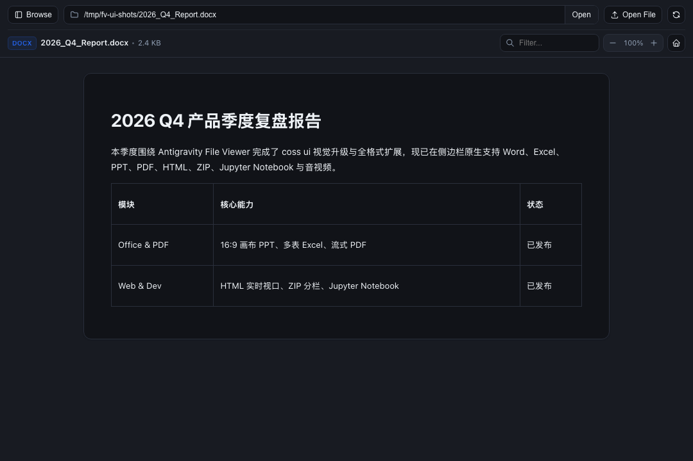
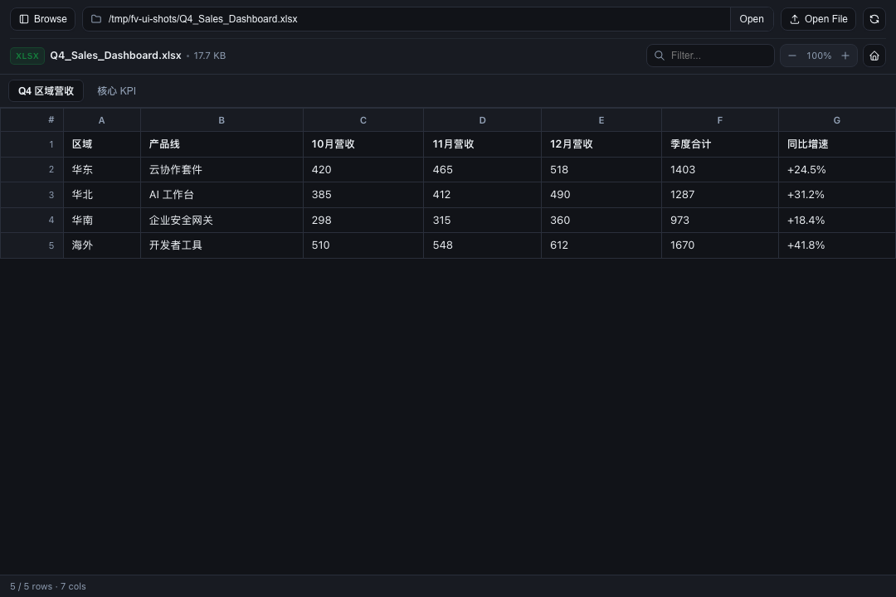
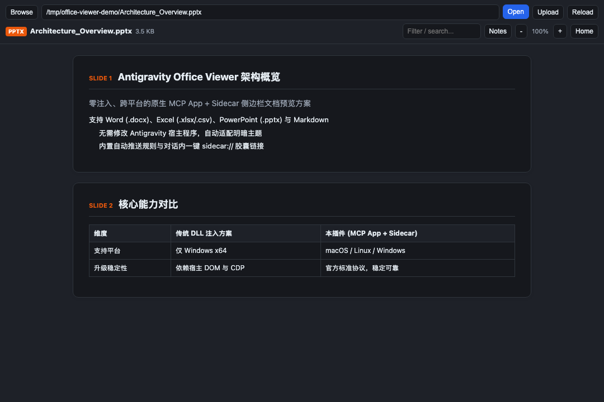

# Antigravity File Viewer

[简体中文](README.md) · **English**

Native **MCP App + Sidecar** universal file viewer plugin for [Google Antigravity](https://antigravity.google/) that previews local **Word, Excel, PowerPoint, PDF, HTML, ZIP archives, and Markdown** files directly inside the Antigravity side pane or full-page sidebar view.

Works natively on **macOS**, **Linux**, and **Windows** using official Antigravity plugin protocols — no DLL injection or patching the host app.

## Screenshots

| Word · `.docx` | Excel · `.xlsx` | PowerPoint · `.pptx` |
| --- | --- | --- |
| [](screenshots/word_preview.png) | [](screenshots/excel_preview.png) | [](screenshots/ppt_preview.png) |

> Click any screenshot to view full size.

## Features

- **Word** (`.docx`, `.dotx`): Clean document paper layout with headings, tables, and embedded images.
- **Excel & Spreadsheets** (`.xlsx`, `.xls`, `.xlsm`, `.xlsb`, `.csv`, `.tsv`, `.ods`): Multi-sheet tabs, sticky row/column headers, merged cell support, cell value inspector bar, and live row filtering.
- **PowerPoint** (`.pptx`, `.pptm`): Full 16:9 slide canvas rendering powered by `pptx-preview`, supporting continuous list / single-slide modes, shapes, tables, embedded images, charts, and speaker notes.
- **PDF** (`.pdf`): Native streaming PDF rendering inside the Sidecar pane (supports text selection, search, outlines, and large files).
- **HTML** (`.html`, `.htm`): Live webpage rendering with relative sibling CSS/JS/image asset resolution, **Preview / Source** toggle, and **Desktop / Tablet / Mobile** viewport presets.
- **ZIP Archives** (`.zip`): File tree explorer with sizes, compression ratio, live filename filtering, and inline preview of text, code, and image entries.
- **Markdown** (`.md`, `.markdown`): Rendered document preview.
- **Auto-Preview & One-Click Chat Pills**:
  - Bundled `rules/AGENTS.md` automatically pushes generated or inspected local files to File Viewer.
  - Supports clickable `sidecar://file-viewer/viewer/?file=<encoded-path>` pill links directly in chat to focus or open the exact file in the side pane.
- **Built-in File Navigation**: Path bar, collapsible local folder browser, recent files history, and drag-and-drop / file picker upload.
- **Native Theme Integration**: Automatically adapts to Antigravity light and dark themes.

## Installation

### Prerequisites
- **Node.js 20+**
- **Google Antigravity** (with MCP Apps & Sidecar support)

### Quick Install

Clone directly into your Antigravity global plugins directory:

```bash
git clone https://github.com/jayden-dong411/antigravity-file-viewer.git ~/.gemini/config/plugins/file-viewer
cd ~/.gemini/config/plugins/file-viewer
npm install
npm run build
```

Antigravity automatically discovers plugins in `~/.gemini/config/plugins/`.

## Usage

1. **Auto-Preview & One-Click Chat Pills**: Whenever the agent creates or inspects a local Office, PDF, HTML, or ZIP file, it pushes the file to File Viewer and includes a clickable `sidecar://` pill link in chat.
2. **Side Pane (`aux_pane`)**: Click the **`+`** button in the Antigravity side pane and choose **File Viewer**.
3. **Full Page (`global`)**: Click **File Viewer** in the left navigation sidebar.
4. **From Chat**: Ask the agent to preview any local file (e.g. `"Open ~/Documents/report.xlsx in File Viewer"`).

## Development

```bash
npm install
npm run build   # Bundles src/app.ts -> dist/app.html & dist/sidecar.html
```

## License

[MIT](LICENSE)
