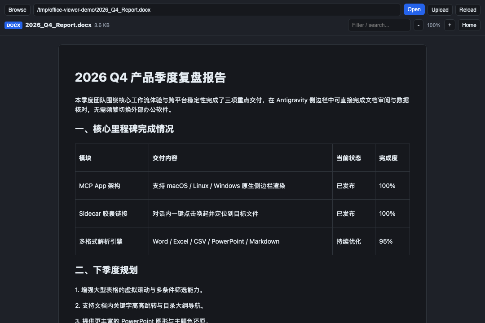
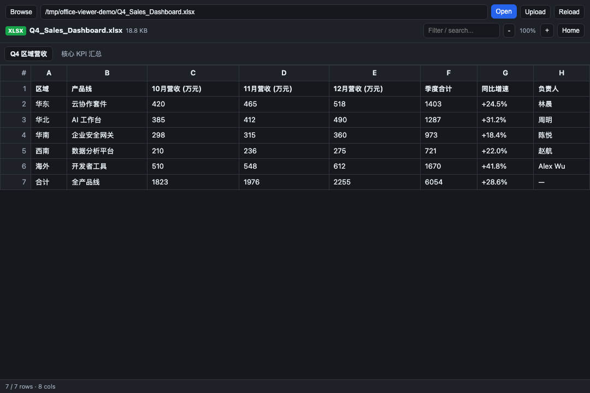
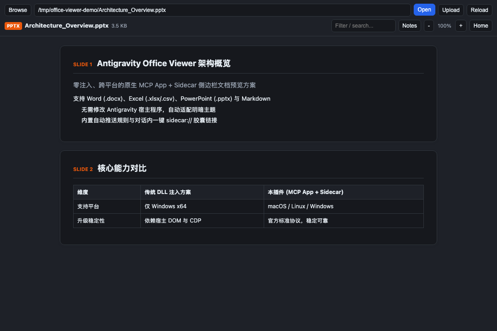

# Antigravity Office Viewer

**简体中文** · [English](README.en.md)

面向 [Google Antigravity](https://antigravity.google/) 的原生 **MCP App + Sidecar** 插件，可在 Antigravity 右侧边栏或全页视图中直接预览本地 Word、Excel、PowerPoint 和 Markdown 文档。

原生支持 **macOS**、**Linux** 和 **Windows**，基于 Antigravity 官方插件协议构建，无需注入 DLL 或修改宿主程序。

## 效果展示

| Word · `.docx` | Excel · `.xlsx` | PowerPoint · `.pptx` |
| --- | --- | --- |
| [](screenshots/word_preview.png) | [](screenshots/excel_preview.png) | [](screenshots/ppt_preview.png) |

> 点击任意预览图可查看高清大图。

## 功能特性

- **Word 预览**（`.docx`、`.dotx`）：清爽的纸张排版视图，保留标题层级、表格与内嵌图片。
- **Excel / 表格预览**（`.xlsx`、`.xls`、`.xlsm`、`.xlsb`、`.csv`、`.tsv`、`.ods`）：多工作表（Sheet）标签切换、冻结首行与行号、合并单元格渲染、单元格内容查看栏、关键字实时过滤。
- **PowerPoint 预览**（`.pptx`、`.pptm`）：纵向连续幻灯片卡片布局，支持标题、层级列表、表格、内嵌图片与可切换显示的演讲者备注。
- **Markdown 预览**（`.md`、`.markdown`）：内置文档渲染视图。
- **自动推送与对话内一键打开**：
  - 内置 `rules/AGENTS.md` 规则：当 Agent 在对话中创建、修改或查找本地 Office 文档时，自动调用 `open_office_viewer` 同步到侧边栏。
  - 支持 `sidecar://office-viewer/viewer/?file=<编码后的绝对路径>` 一键胶囊链接，点击即可在右侧边栏直接打开对应文档。
- **内置文件导航**：支持路径直达、可折叠本地目录浏览器、最近打开记录，以及直接从访达（Finder）拖拽或选择文件上传预览。
- **原生主题适配**：自动跟随 Antigravity 明暗主题配色，支持缩放控制。

## 安装方法

### 环境要求
- **Node.js 20 及以上**
- **Google Antigravity**（支持 MCP App 与 Sidecar 插件）

### 一键克隆安装

直接克隆到 Antigravity 全局插件目录并构建即可，Antigravity 会自动发现并加载插件：

```bash
git clone https://github.com/jayden-dong411/antigravity-office-viewer.git ~/.gemini/config/plugins/office-viewer
cd ~/.gemini/config/plugins/office-viewer
npm install
npm run build
```

## 使用方式

1. **自动预览与对话内胶囊链接**：让 Agent 生成、整理或查看本地 `.docx` / `.xlsx` / `.csv` 等文档时，会自动推送到 Office Viewer 并在回复中提供一键预览胶囊链接。
2. **右侧边栏打开（`aux_pane`）**：点击 Antigravity 右侧辅助面板的 **`+`** 按钮，选择 **Office Viewer**。
3. **左侧全页打开（`global`）**：点击左侧导航栏中的 **Office Viewer**。
4. **手动指定预览**：在对话中直接发送文件路径，例如：`"在 Office Viewer 中打开 ~/Documents/report.xlsx"`。

## 项目结构

```text
├── plugin.json              # Antigravity 插件清单
├── mcp_config.json          # MCP 服务配置
├── bin/
│   ├── start.sh             # 跨平台 Node.js MCP 启动脚本
│   └── sidecar.sh           # Sidecar Web 面板启动脚本
├── sidecars/viewer/
│   └── sidecar.json         # Sidecar 侧边栏面板声明
├── rules/AGENTS.md          # 自动推送侧边栏与胶囊链接规则
├── skills/office-viewer/    # Agent 技能说明
├── src/
│   ├── server.mjs           # MCP 服务端（工具与 ui:// 资源）
│   ├── sidecar-server.mjs   # Sidecar 本地 HTTP 预览服务
│   ├── parsers.mjs          # Office 文档解析引擎
│   └── app.ts               # 双模式交互式前端界面
├── scripts/build.mjs        # 单文件 HTML 打包脚本（esbuild）
├── dist/
│   ├── app.html             # MCP App 单文件前端产物
│   └── sidecar.html         # Sidecar 单文件前端产物
├── screenshots/             # README 预览截图
└── assets/logo.svg          # 插件图标
```

## 本地开发

```bash
npm install
npm run build   # 打包生成 dist/app.html 与 dist/sidecar.html
```

## 许可证

[MIT](LICENSE)
